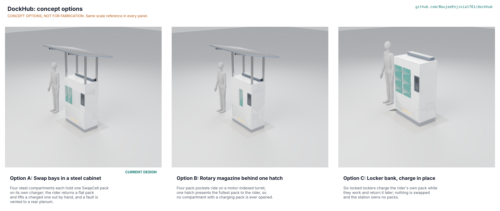

# DockHub concept options

Result: option A, swap bays in a steel cabinet (the current design), scores **120**, option B, a rotary magazine behind one hatch, **102**, and option C, a locker bank where each rider charges their own pack in place, **90**, out of a possible 155. A leads B by 15 %, more than the 10 % that would send both to Amish. **Recommendation, proposed, awaiting Amish: carry option A.** The design is not changed by this document. All three options are modelled to detail level D3 in `cad/src/model.py`; the picture below is rendered from those models with `python .kit/options.py`. Method: STANDARDS section 21.

## The options

### Option A: swap bays in a steel cabinet (current design)

A 1,000 x 500 x 1,500 mm riveted steel cabinet on a channel plinth has four bays in a row, two fitted in the first prototype. Each bay is a steel compartment with a locked door, a cradle and a SwapCell receptacle, and its own charger and CAN channel. The rider taps a card, returns a flat pack to an empty bay and takes a charged one from another, in about 31 s. A 400 W canopy feeds bay 1; a rear plenum and roof hood vent a failed pack away from the street. Risks: R8 fire containment and R9 hot-day charging are at risk; cost is $319 over the target.

### Option B: rotary magazine behind one hatch

The same cabinet shell holds a motor-indexed turret with four pockets, each with its own cradle and receptacle, behind a single hatch. The rider puts a flat pack in the hatch pocket and the turret indexes a charged one round to it. One door to guard and seal replaces four, and the pack store is out of reach. Risks: power and data must cross a rotating joint (a slip ring or a flexible lead), not modelled in detail; the turret is a single enclosure for all packs, so a runaway can reach neighbours more easily; one hatch serves one rider at a time; a bought indexing table adds cost (price to assess).

### Option C: locker bank, charge in place

Six steel lockers in two columns of three, each with its own door, lock, receptacle and charger. A rider leaves their own SwapCell pack to charge in a locker and returns for it later; there is no pool of packs and no swap. The canopy and MPPT are dropped. Risks: the rider waits hours, not a minute; unvetted packs are stored and charged unattended; six chargers draw about 1.8 kW at once; the top row sits above the comfortable reach range.

## First-order numbers

Table 1. Options compared (D3 model figures from `cad/fidelity.json`; masses include the 1,109 kg site pad and anchors).

| Quantity | Option A | Option B | Option C |
| --- | --- | --- | --- |
| Parts in the D3 model (with fasteners and welds) | 537 | 550 | 572 |
| Mass of the D3 model (kg) | 1,343.8 | 1,374.1 | 1,318.3 |
| Priced parts cost, two bays (USD) | 1,519 (priced BOM, with anchors and pad) | To assess | To assess |
| Swap time | 31 s | About 31 s plus index time (to assess) | None; the rider waits for a charge |
| Packs in the pool | 3 of 4 bays | 3 of 4 pockets | None (riders' own) |
| Doors | 4 bay doors plus a service door | 1 hatch plus a service door | 6 locker doors plus a service door |
| Moving parts besides doors | 0 | Turret and indexer | 0 |
| STEM check | Open, one fix made (D1) | Plausible (rotary power transfer) | Within, fire rows open |

## Scoring

Table 2. Weighted scoring (weights: High UR 3, Medium 2, Low 1; scores 1 to 5; maximum 155).

| Criterion | Source | Weight | A | B | C | Reason |
| --- | --- | --- | --- | --- | --- | --- |
| Fast swap | UR-001 | 3 | 4 | 4 | 1 | A: 31 s task; B adds the turret index time; C has no swap, the rider waits for their own pack to charge |
| A charged battery is there | UR-002 | 3 | 4 | 3 | 2 | A: 36 a day ceiling from 4 bays; B: one hatch serves one rider at a time; C: six lockers hold six riders for hours |
| No fire danger | UR-003 | 3 | 3 | 2 | 3 | A: steel compartment per bay with aerosol and vent; B: packs share one turret enclosure; C: steel locker per pack but unvetted riders' packs |
| Works outdoors all year | UR-004 | 3 | 4 | 3 | 3 | B has a rotating joint to seal; C has six gasketed doors |
| Uses the open battery | UR-005 | 3 | 5 | 4 | 4 | B needs power and data across a rotating joint; C charges the pack in place but does not use the swap interface for exchange |
| Stays up in a storm | UR-006 | 3 | 3 | 3 | 4 | C has no canopy; A and B need the pad (equilibrium factor 1.12) |
| Hard to rob or tamper with | UR-007 | 2 | 4 | 5 | 3 | B has one hatch to guard; C stores riders' own packs in public lockers |
| Everyone can use it | UR-008 | 2 | 5 | 4 | 2 | A operable range 0.73 to 1.10 m; C's rows are fixed by the lockers, top row above 1.19 m |
| Small and easy to power | UR-009 | 2 | 4 | 4 | 3 | C's six chargers draw about 1.8 kW at once, over the 1.5 kW single-circuit target unless limited |
| No watching me | UR-010 | 2 | 4 | 4 | 4 | No option adds cameras |
| Quick to mend | UR-011 | 2 | 4 | 2 | 4 | B has an indexer, motor and slip ring behind the hatch |
| Affordable to build | UR-012 | 2 | 3 | 2 | 3 | A $1,519 priced; B adds a bought indexing table (price to assess); C drops the canopy and MPPT (about $250) but adds four chargers and doors |
| Some of it from the sun | UR-013 | 1 | 3 | 3 | 1 | C has no canopy |
| **Weighted total** | | | **120** | **102** | **90** | |

## Decision

**Proposed, awaiting Amish: option A**, the current design, because:

- It is the only option that delivers the fast swap (UR-001) and a pool of charged packs (UR-002), the two things riders asked for, and it keeps the swap interface the SwapCell project defines (UR-005).
- Its steel compartment per bay is the best of the three on fire containment (UR-003), though that row is still at risk (DKH-STM-001 S11).
- Option B is the nearest alternative (102): worth revisiting if a single hatch matters more than the extra moving parts, or if the propagation trial favours a magazine. Option C is a different product (a charging locker, not a swap station) and fails the two High needs on speed and availability.

The precis (DKH-PRC-001) and every TRL 3 document describe option A. `project.yaml` records `concept_chosen: A (proposed)`. Options B and C stay in the model at D3 as alternatives. The decision record is DKH-DDR-004.
